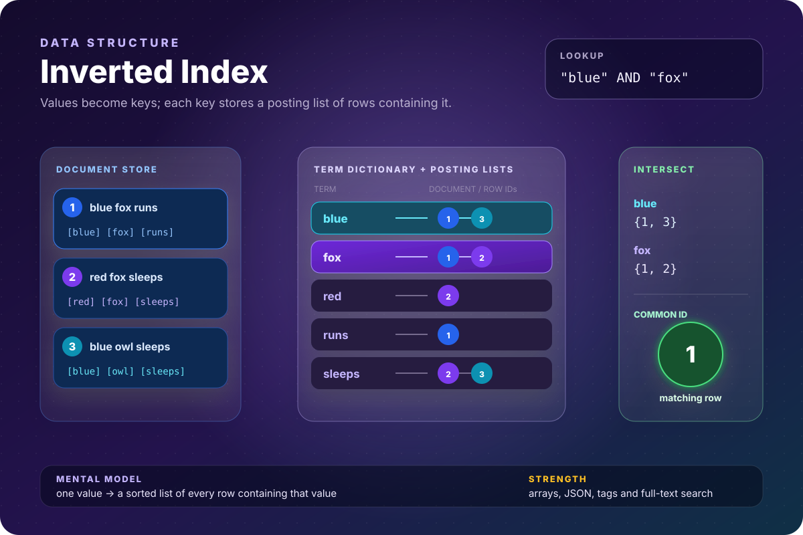
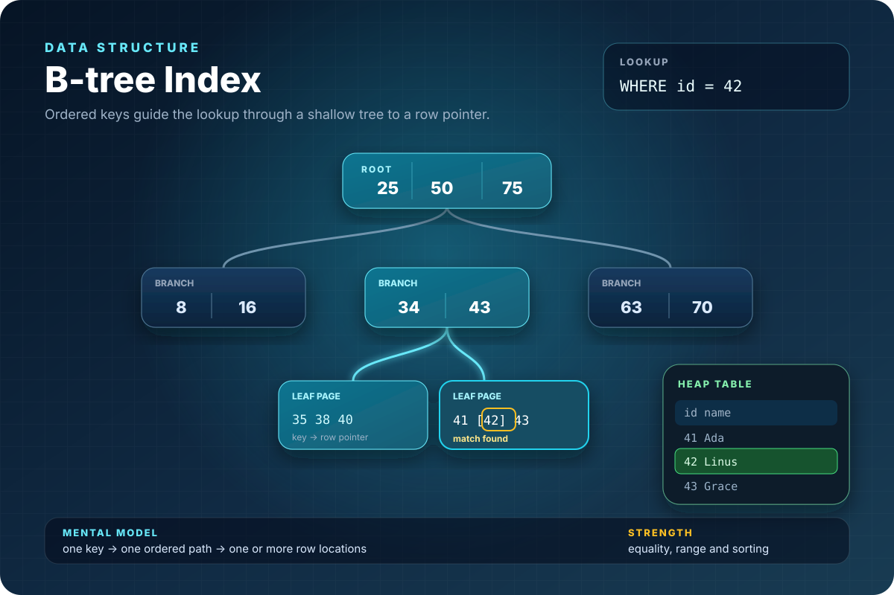
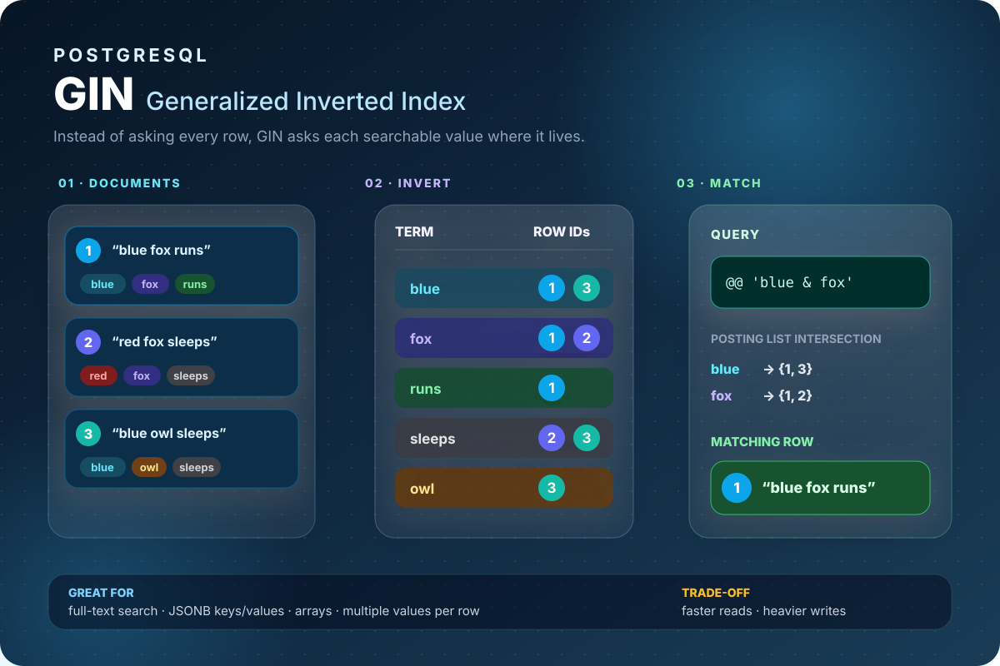

# Inverted Index


Postgres calls it's implementation of inverted index as **GIN** - Generalize Inverted Index. Here's a simple example of how it's used

```sql
CREATE TABLE articles (
    id    serial PRIMARY KEY,
    title text,
    tags  text[]
);

INSERT INTO articles (title, tags) VALUES
('Postgres internals',     ARRAY['postgres','database','indexing']),
('Kubernetes networking',  ARRAY['kubernetes','networking','cni']),
('Istio service mesh',     ARRAY['istio','kubernetes','servicemesh']);

-- create the GIN index, on tags
CREATE INDEX idx_articles_tags ON articles USING gin (tags);

-- now query using the contains operator
SELECT title FROM articles WHERE tags @> ARRAY['kubernetes'];
```

@> is postgres **contains** operator, used to query 'does it contain'


## Data Structure

Indices are implemented in postgres as b-trees existing independantly of the table.




Inverted indices are composed of two b-trees - an Entry tree and a Posting tree. Let's go though the idea, with this example table,

┌────────┬──────────────────┐
│ Row ID │ Words            │
├────────┼──────────────────┤
│ 1      │ Lord of the Rings│
├────────┼──────────────────┤
│ 2      │ Game of thrones  │
├────────┼──────────────────┤
│ 3      │ Rings and Thrones│
└────────┴──────────────────┘

So, the index is supposed to be like this, logically,
"Lord"    --> [1]
"Game"    --> [2]
"Rings"   --> [1,3]
"Thrones" --> [2,3]


Basically a dictionary to a list of rows. 



