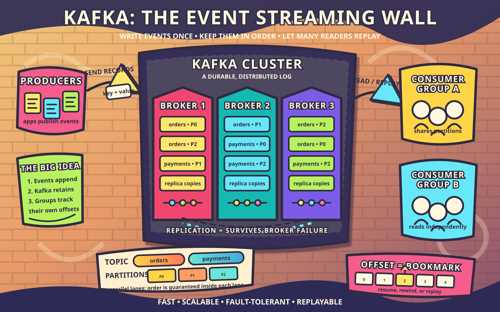
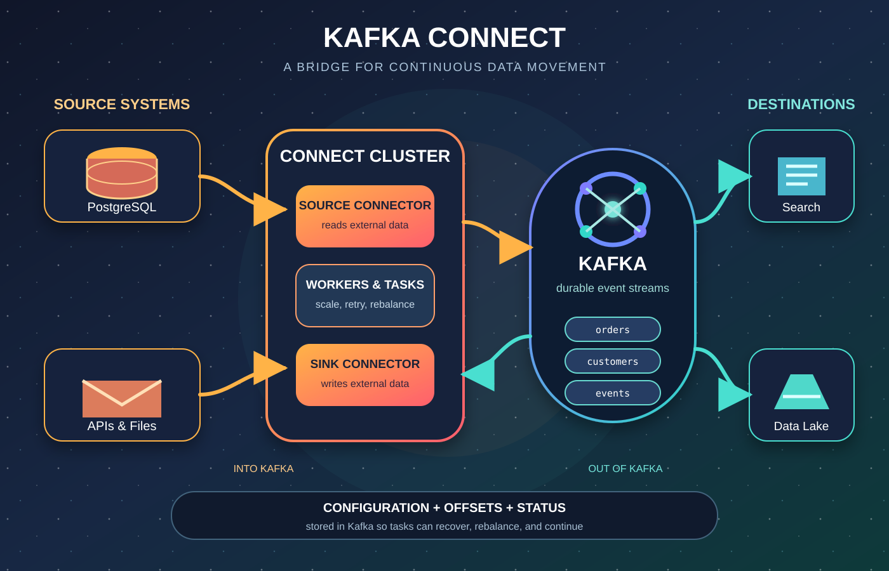

Kafka is a **distributed, partitioned, replicated commit log**

* Producers **append** records to end of log.
* Consumers read from an **offset**

Nothing is removed on consumtion (retention is configured independently), that is how it is durable and distributed.

# Kafka components

**Broker**
The kafka server - it owns the storage where the message log lives, and servers reads/writes for partions it hosts.

**Topic**
A logical stream composed of multiple independent partition logs. Think of it as logical grouping of log files across brokers.

Think of a Kafka topic as a highway and its partitions as separate lanes.
Topic: orders
Partition 0: [order A] → [order C] → [order F]
Partition 1: [order B] → [order D]
Partition 2: [order E] → [order G]

**Partition**
The actual log file. Physically, it's segmented into a group of segment files (default 1 GB each), with the oldest ones being rolled over based on retention policy and storage.

**Producer**
Client that appends records. It picks a partition per record (via key hash, explicit partition, or round-robin), batches records client-side for throughput, and gets an ack back per your acks setting (0 = fire and forget, 1 = leader only, all = full ISR).

**Consumer**
A consumer reads a partition sequentially by tracking its own offset (stored in an internal Kafka topic, __consumer_offsets, not in the broker's head).

## Kafka Connect
Kafka connect is a framework for declaratively connecting systems together using generic kafka clients.

eg: Database --> Source Connector --> Kafka Topics --> Sink Connector --> Elasticsearch 

