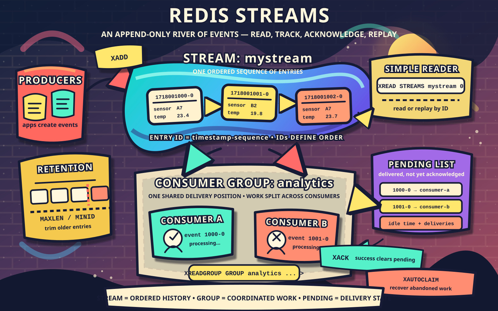

# Redis Streams

Redis Streams implements a Kafka-like message queue using the following commands:

- `XADD` adds a message to a stream.
- `XREADGROUP` reads messages as a consumer-group member.
- `XACK` acknowledges completed messages.
- `XPENDING` inspects unfinished messages.
- `XCLAIM` recovers abandoned messages.

## `XADD` — Publish

```text
XADD orders * customer 123 product laptop
```

- `orders`: stream name
- `*`: Redis generates the message ID
- Remaining arguments are field-value pairs

Example result:

```text
"1723100000000-0"
```

## `XREADGROUP` — Consume

First, create a group:

```text
XGROUP CREATE orders workers 0 MKSTREAM
```

Then read from the stream:

```text
XREADGROUP GROUP workers worker-1 COUNT 10 BLOCK 5000 STREAMS orders >
```

- `workers`: consumer group
- `worker-1`: consumer name
- `>`: messages never delivered to this group
- `COUNT 10`: retrieve up to ten messages
- `BLOCK 5000`: wait up to five seconds

Delivered messages enter the group's Pending Entries List (PEL) until acknowledged.

## `XACK` — Acknowledge Completion

```text
XACK orders workers 1723100000000-0
```

This removes the message from the group's PEL. It does not delete the message from the stream.

## `XPENDING` — Inspect Unfinished Work

Summary:

```text
XPENDING orders workers
```

Detailed entries:

```text
XPENDING orders workers - + 10
```

The result includes:

- Message ID
- Current consumer
- Idle time
- Delivery-attempt count

## `XCLAIM` — Recover Abandoned Work

```text
XCLAIM orders workers worker-2 60000 1723100000000-0
```

This transfers the message to `worker-2` if it has been idle for at least `60000` milliseconds.

## Typical Lifecycle

```text
XADD → XREADGROUP → process → XACK
                         ↓ failure
                   XPENDING → XCLAIM → retry → XACK
```

## Kafka vs. Redis Streams

| Dimension | Kafka | Redis Streams |
| --- | --- | --- |
| Partitioning | Native — a topic is N partitions, each independently replicated and consumed | A single stream key lives on one node; there's no automatic partitioning across instances [Readthedocs](https://redis-doc-test.readthedocs.io/en/latest/topics/streams-intro/) — to fan out you use multiple keys plus Redis Cluster or app-level sharding [Readthedocs](https://redis-doc-test.readthedocs.io/en/latest/topics/streams-intro/) |
| Ack model | Consumer commits an offset per partition (coarse, positional) | Each entry is tracked in a Pending Entries List until the consumer explicitly `XACK`s it [OneUptime](https://oneuptime.com/blog/post/2026-03-31-redis-xreadgroup-consumer-groups/view) — per-message, not per-partition |
| Durability | Leader + ISR replication, `acks=all` blocks until every in-sync replica has it | AOF/RDB persistence, async replication by default; Sentinel/Cluster failover is best-effort and can promote a replica that's missing recent data [Readthedocs](https://redis-doc-test.readthedocs.io/en/latest/topics/streams-intro/) |
| Write latency | ~1–5ms with `acks=all`, since the write path replicates before acking [PipeCode](https://pipecode.ai/blogs/redis-streams-real-time-consumer-groups-xadd-xread) | ~60–200 microseconds warm-socket round trip [PipeCode](https://pipecode.ai/blogs/redis-streams-real-time-consumer-groups-xadd-xread) — single-threaded event loop over epoll/kqueue [PipeCode](https://pipecode.ai/blogs/redis-streams-real-time-consumer-groups-xadd-xread) |
| Retention | Disk-backed, size/time-based, can be huge (tiered to object storage now) | Effectively RAM-bound; trimmed via `MAXLEN`, not built for deep long-term retention |
| Ops footprint | Broker cluster + KRaft controllers, plus Schema Registry and Connect if you want connectors, plus rebalance-aware consumers [PipeCode](https://pipecode.ai/blogs/redis-streams-real-time-consumer-groups-xadd-xread) | One process, or a small cluster of shard-owner processes [PipeCode](https://pipecode.ai/blogs/redis-streams-real-time-consumer-groups-xadd-xread) |
| Cross-consumer-group isolation | Strong — any number of independent groups replay the full log at their own pace | Same mechanism, same guarantee — this part genuinely is equivalent |
